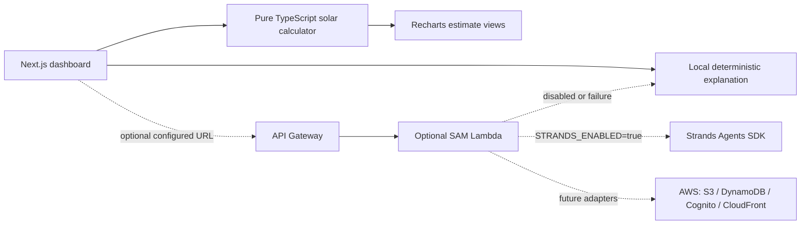

# SolarSmart

A local-first solar planning dashboard. Its core calculation and demo experience work without an AWS account, payment card, API key, login, or AI subscription.

## Quick start

Requirements: Node.js 20+ and npm. From the project directory:

```sh
npm install
npm run dev
```

Open http://localhost:3000. The prominent **DEMO MODE** badge indicates the local sample experience. Use **Reset demo** to instantly restore assumptions. Nothing is uploaded, and no credentials are needed.

## What the estimate means

The calculator in `src/lib/solar.ts` is a deterministic, separately tested TypeScript module. It uses explicitly entered assumptions: average bill, utility rate per kWh, peak sun hours, system cost, incentive assumption, utility price escalation, and bill offset. The demo rate ($0.15/kWh), sun hours, system cost, and CO₂ factor are illustrative placeholders only; the app never treats them as your actual tariff, subsidy, or live irradiance. The demo incentive is 0%. A generic 80% system sizing factor is also used. This is not an installer quote or a prediction. Verify tariff, eligibility, production, and costs with local sources and qualified professionals. The app does not claim government approval or quote live irradiance.

## Checks

```sh
npm test
npm run typecheck
npm run lint
npm run build
```

## Architecture



The browser calculator and demo are independent of the backend. The API and AWS resources are opt-in. Never move private credentials into `NEXT_PUBLIC_*` variables or frontend bundles.

## LocalStack

LocalStack is not included: the app creates no S3 or DynamoDB resources, and SAM Local already covers the optional Lambda/API route. If you later add AWS services, use LocalStack only after checking that the specific service and feature are supported by your chosen LocalStack edition; no LocalStack edition is required or assumed here. Strands/Bedrock model access is not part of the local demo and may still require AWS credentials and paid model usage.

## Optional local SAM API and Strands

The optional explanation function is Python 3.12 with AWS SAM CLI and Docker for local emulation. Install `backend/requirements.txt` into the SAM build. It accepts *already calculated numeric results* and only explains them. By default Strands stays disabled and the handler uses a deterministic fallback. To enable Strands, set `STRANDS_ENABLED=true`, a supported `STRANDS_MODEL_ID`, and configure server-side AWS credentials and Bedrock model access. Calls may incur model charges. Without credentials, the web app continues using its local explanation.

```sh
sam build
sam local start-api
```

To connect the frontend to the local API, set `NEXT_PUBLIC_API_BASE_URL=http://127.0.0.1:3001` in `.env.local` and restart Next.js. (The deployed API output includes its `/Prod` stage.) Core functionality does not require SAM, Docker, AWS, or Strands.

## Optional AWS deployment

Do not deploy as part of local setup. Before deployment, review the exact SAM change set and AWS pricing/quotas for your region and account. This template creates an API Gateway REST API and Lambda function (plus CloudFormation-managed resources). Lambda and API Gateway can incur request, compute, logging, and data transfer charges; Bedrock is separately metered if Strands is enabled. As checked on 2026-10-08, AWS lists Lambda monthly free usage (including 1M requests and 400,000 GB-seconds) and an API Gateway REST API free offer (1M calls/month for eligible new customers for up to 12 months). These are conditional offers, not a promise of free deployment: AWS account plan/age, region, current pricing, usage, credits, and other charges affect eligibility. Review [AWS Free Tier](https://aws.amazon.com/free/), [Lambda pricing](https://aws.amazon.com/lambda/pricing/), [API Gateway pricing](https://aws.amazon.com/api-gateway/pricing/), and the target region's [Service Quotas](https://docs.aws.amazon.com/servicequotas/latest/userguide/intro.html) before deploying. Deployment requires AWS credentials, account access, and SAM CLI. Never assume deployment is free.

```sh
sam deploy --guided
```

Review the stack resources and charges before confirming. Cleanup: `sam delete` (review the stack name/region first), then check CloudFormation for remaining resources and CloudWatch logs. No S3, DynamoDB, Cognito, or CloudFront resources are created by the included template; they are clean future integration points, not startup requirements.

## Privacy and troubleshooting

- `.env.example` lists optional settings; local mode needs none. Keep real secrets in server-side secret storage, never `NEXT_PUBLIC_*`.
- User inputs stay in browser state in demo mode. The export button creates a local text file; there is no file upload.
- If install fails, check Node.js 20+ and rerun `npm install`. If port 3000 is busy, run `npm run dev -- -p 3002`.
- If a chart is blank, reload and confirm JavaScript is enabled. The calculator outputs are available without charts.
- If SAM local startup fails, install Docker and SAM CLI; otherwise simply skip the optional API.
- If optional Strands fails due to missing model permissions, region, or credentials, disable it and retain the fallback. Model calls may be billable.
