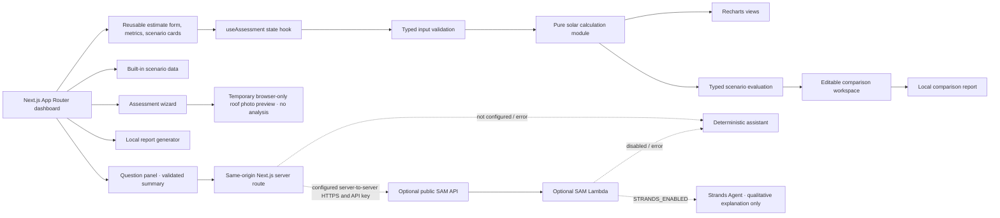

# SolarSmart

A local-first rooftop solar planning application for households and small property owners. Roof layout, shade, energy use, utility rates, installation costs, and export rules all affect a solar decision; SolarSmart puts a transparent first estimate and practical follow-up steps in one experience. It does not certify a roof, confirm eligibility, or guarantee savings.

The complete assessment and demo run locally after dependencies are installed. No AWS account, payment card, API key, login, or AI subscription is needed. All built-in scenarios are illustrative and labelled as demo data.

## Quick start

Requirements for the core application: Node.js 20 or newer and npm. npm is the package manager for this repository (`package-lock.json` is checked in). From the project directory:

```sh
node --version
npm ci
npm run dev
```

Open [http://localhost:3000](http://localhost:3000). The home page introduces the estimate, shows a computed sample preview, and links to a real sample report and the assessment at `/assessment`. The no-query assessment route opens the four-step property wizard; completing it opens the dashboard with submitted inputs. `/assessment?scenario=balanced` opens the built-in medium-roof dashboard demo directly. The core demo makes no external requests, uploads, or credential checks.

To build and serve the production version locally:

```sh
npm run build
npm run start
```

The production server defaults to port 3000. For a different port, set `PORT` in the shell before `npm run start`.

## Demo walkthrough

Start from **Check My Solar Potential** or **Try sample data** in the wizard. Enter a general city/postcode, property and roof details, and either a monthly bill or kWh consumption. Review or edit each section before calculating. Roof area supports sq ft and m²; unknown tariffs and orientation use disclosed generic assumptions. **Restart** clears the wizard, while **Cancel** returns home. Calculation opens the dashboard with the entered roof, shading, orientation, rate, and energy values mapped into the same deterministic model. The dashboard’s **Edit assessment** returns to the reviewed wizard inputs. Use **Compare scenarios** to open a dedicated decision-support workspace: keep the assessment as the fixed baseline, create/rename/duplicate/remove alternatives, adjust assumptions, and export a side-by-side report. The comparison pins baseline annual kWh (inferred from bill and tariff if no explicit use was collected), so a tariff what-if changes price without silently changing consumption. **Reset samples** restores the three alternatives; **Reset comparison** also resets the local comparison state. The separate sample scenario routes remain available; **Reset demo** restores dashboard defaults. The Report panel provides text/CSV exports, browser printing, and optional local history. **Ask about this assessment** uses the deterministic local assistant unless you deliberately configure a server-side Strands service.

At tablet widths the header collapses to an accessible menu; at phone widths scenario cards and the footer stack, while metric cards remain in a two-column grid. Navigation links jump to real page sections. No external imagery, account, or remote service is needed for the walkthrough.

### Three-minute judge presentation

1. **Frame the problem:** Rooftop solar decisions involve roof suitability, system size, energy use, utility rates, installation cost, savings, and payback. These are difficult to reason about when assumptions are scattered or hidden.
2. **Introduce the solution:** Open the landing page. Point out the sample preview, prominent assessment action, and estimate-only / demo labels. Explain that a city or postcode is context only; the app does not look up a home or pretend to have live solar data.
3. **Run an assessment:** Choose **Check My Solar Potential**, then **Try sample data**. Review the property and roof, energy input, preferences, and final review; edit a value to show the wizard preserves inputs. Submit to open the results dashboard.
4. **Explain the result:** Walk through modeled capacity, annual generation, bill savings, illustrative cost range, payback availability, and estimated avoided emissions. Show source-labelled inputs and assumptions, limitations, and deterministic next steps.
5. **Compare decisions:** Choose **Compare scenarios**. Select or edit a small-roof or shaded alternative and show the shared calculator updating deltas. Mention when a preset changes multiple assumptions, so the result cannot be attributed to one cause.
6. **Show transparency and optional help:** Review the calculation assumptions and ask a suggested question. With no model endpoint configured, the assistant uses its deterministic local answer; if a model is deliberately configured, it can provide qualitative explanation while SolarSmart's calculation engine remains the source of every number.
7. **Close with a report and architecture:** Open **Report**, show that values match the dashboard, and use text/CSV export or browser print. Explain that reports, calculator, demo scenarios, and local history do not need AWS; the SAM API is an optional server-side enhancement.

For a fast judge path, start at `/`, click **Check My Solar Potential**, choose **Try sample data**, submit, select a comparison scenario, then open **Report**. **Reset demo** returns the dashboard to its intended medium-roof sample; **Restart** clears the wizard.

### Product choices and what is distinctive

SolarSmart's useful distinction is the flow from an approachable intake to traceable estimates: the wizard, editable scenarios, dashboard, recommendations, and export all use one deterministic calculation contract. It separates entered values, model assumptions, calculated facts, and unknowns in the UI. The scenario workspace makes trade-offs visible while warning when several variables change together. Optional AI explains a structured summary only; it cannot become a second financial calculator. This is a product and architecture choice, not a claim of a new scientific solar model or proven user outcome.

Future extensions could add validated location-specific weather and tariff sources, installer quote comparison, account-based syncing, or a tested vision method. Each would need disclosed provenance, user consent, security and retention design, and a comparison against the current deterministic assumptions before it could replace or augment demo inputs. None is represented as implemented today.

## What the estimate means

The calculator in `src/lib/solar.ts` is a pure, deterministic, separately tested TypeScript module. It returns a versioned typed schema with calculation assumptions, annual projections, warnings, limitations, completeness, and confidence. Consumption from a bill is inferred as bill × 12 ÷ entered/disclosed tariff. System sizing uses a target annual consumption offset and is capped by usable-roof capacity (60 sq ft/kW). Generation applies peak sun-hours × 365 × generic 80% performance × orientation × shade. The financial model distinguishes an illustrative physical self-consumption share from exports: self-consumed kWh offset the retail rate, while exports use only the explicit export-compensation input (zero by default). Installation cost range, incentive adjustment, degradation, tariff growth, payback, and emissions use documented assumptions. Charts and reports consume the engine’s annual projection instead of recalculating it. See [the full model documentation](docs/calculation-model.md) for formulas, units, constants, bounds, and limits.

Rates, sun-hours, roof area, cost, self-consumption, export compensation, performance, degradation, and the generic 0.385 kg CO₂/kWh factor are illustrative or user-provided, not local verified facts. Subsidies default to 0%; any entered incentive is unverified and warned. Results are estimates, not installer quotes, engineering assessments, approvals, or guarantees. Actual generation and costs depend on site, equipment, local conditions, utility rules, and installation quality.

## Optional roof photo preview

The Roof and site step accepts an optional JPEG, PNG, or WebP file up to 8 MB. The browser validates the declared image type and size, decodes it locally, applies preview dimension limits, and displays a temporary preview. Cancel, remove, Restart, replacement, or leaving the wizard clears or releases that preview. The image is not uploaded, saved in assessment history, included in reports, or sent to the optional assistant. It does not affect the calculation; users still enter usable area, shading, and orientation manually. This project has no configured vision model or image-analysis dependency, so SolarSmart makes no machine-generated roof observations. A photo alone cannot establish area, structural condition, production, eligibility, or engineering safety.

Invalid provided inputs return structured validation errors; missing data yields `null` estimates and warnings. Zero bill/zero roof does not divide by zero, a zero tariff is invalid, and payback beyond the 25-year modeled horizon remains unavailable. Invalid edits hide dependent dashboard results until corrected. Scenario comparison uses the same engine, keeps baseline usage fixed while editing the tariff, and marks invalid alternative outputs unavailable.

The results dashboard includes six summary metrics, an engine-backed annual generation/savings/cost-recovery chart set, dashboard scenario switching for small, medium, and highly shaded sample roofs, and a dedicated CRUD comparison workspace at `/assessment/compare`. It includes source-labelled inputs/assumptions/calculations, limitations, deterministic next-step recommendations, and a checklist. **Report** opens a current-result report preview with plain-text and structured CSV export, plus browser printing (choose “Save as PDF” in the browser print dialog). The report is rebuilt from the current calculation output; it does not contain a second calculator. A valid assessment can be explicitly saved from the report to optional local browser history. History supports reopen, rename, delete, and clear all. Its versioned schema migrates known older entries, skips malformed entries with a notice, and preserves unsupported future versions rather than overwriting them. Local storage may be unavailable or cleared by browser privacy settings. Monthly production is intentionally left unmodelled because the app has no defensible seasonal or location-specific profile.

## Known limitations

- Solar yield, emissions factor, equipment performance, and default financial inputs are generic planning assumptions, not a local forecast, live measurement, quote, or verified tariff.
- A city/postcode is not geocoded. Roof images are only previewed locally; there is no vision service or dimension measurement.
- The model does not inspect roof structure, wiring, permitting, legal eligibility, utility approvals, or installer quality. A qualified local professional must assess those conditions.
- Savings and simple payback exclude financing, maintenance, insurance, taxes, fixed utility charges, and changing export terms. No subsidy is assumed by default; any user-entered incentive remains unverified.
- Local history and comparison handoff data remain in the current browser and do not sync across devices. Browser storage settings may clear or block saved history.
- Strands/Bedrock explanation is optional and may incur inference charges. AWS account resources, cloud history, hosted web delivery, and uploaded image storage are not part of the core demo.

## Checks

```sh
npm test
npm run typecheck
npm run lint
npm run build
python -m unittest discover -s backend
```

The first four commands check the Next.js app, TypeScript, and frontend tests. The Python command checks the optional Lambda handler's validation and fallback logic; it does not invoke AWS or a model. SAM validation/build and Docker-backed Lambda emulation are optional checks and require their respective tools.

## Technology stack and rationale

- **Next.js App Router + React + TypeScript:** typed page routing, server/client boundaries, and a maintainable UI without requiring a separate hosted API for the local experience.
- **Tailwind CSS / repository CSS design tokens:** utility styling plus shared semantic colors, spacing, focus states, and responsive rules. The reusable controls in `src/components/ui` are accessible project components; shadcn/ui is not a runtime dependency.
- **Recharts:** responsive charts receive the calculation engine's projection data. They do not make independent solar or financial calculations.
- **Vitest:** fast unit tests for deterministic calculations, validation, comparison, reports, persistence, assistant contracts, and image handling.
- **Python 3.12 + AWS SAM + optional Strands Agents:** only for the optional serverless explanation API. It is not required to run, test, or build the core Next.js experience.

No remote image host, font service, analytics provider, database, or AI client SDK is required by the browser demo.

## Architecture



Component boundaries: `src/app/page.tsx` composes the landing page; `src/app/assessment/page.tsx` routes between the wizard and optional scenario demo; `src/components/solar/assessment-wizard.tsx` owns the step UI and review, `src/lib/assessment.ts` defines and validates its separate raw-data model and adapter, and `src/components/solar/assessment-flow.tsx` hands validated inputs into `src/components/solar/assessment-dashboard.tsx`. `src/app/assessment/compare/page.tsx` and `src/components/solar/comparison-experience.tsx` provide CRUD scenario comparison; `src/lib/comparison.ts` evaluates each variant with the existing pure solar engine and builds safe absolute/relative differences; `src/lib/comparison-storage.ts` uses one-time session storage only for the browser handoff. See [scenario comparison design](docs/scenario-comparison.md). `src/components/ui` provides design-system controls; `src/hooks/use-assessment.ts` owns local calculation/dashboard state; `src/lib/validation.ts` validates calculator inputs; `src/lib/solar.ts` computes results; `src/lib/scenarios.ts` contains fictional demo data; `src/lib/ai/fallback.ts` and `src/lib/services/explanation-client.ts` handle optional explanation; `src/lib/report.ts` formats reports. The core app has no cloud data-access dependency. Never move private credentials into `NEXT_PUBLIC_*` variables or frontend bundles.

## Delivery status

Implemented: local multi-step rooftop assessment wizard with review/edit/restart, deterministic roof and savings estimate, validation, demo scenario comparison/reset, savings chart, question-aware deterministic assistant, optional server-side Strands integration, current-result text/CSV/print report, opt-in versioned local assessment history, and responsive accessible dashboard.

Not wired because the local-first demo does not need them: user accounts/Cognito, persistent cloud scenarios, S3 report/image storage, DynamoDB records, CloudFront hosting, live tariff/irradiance feeds, address lookup, or automated installer matching. The optional SAM template does provision a bounded-retention CloudWatch log group for its assistant Lambda. No partnerships, government data, or subsidy database are claimed. Add other services only for a demonstrated need, with a verified data source, privacy review, and explicit opt-in configuration.

### Implemented versus prepared integrations

| Integration | Current status |
| --- | --- |
| Local Next.js UI, wizard, calculation engine, sample data, charts, comparison, report, local history | Implemented; does not need AWS credentials or network access at runtime. |
| Strands explanation endpoint | Optional server-side Lambda/API integration is implemented in `backend/app.py` and `template.yaml`; defaults disabled and has deterministic fallback. Model inference was not verified as part of the local demo. |
| AWS Lambda, API Gateway, CloudWatch | Included in the optional SAM assistant stack. SAM template validation/deployment status depends on running SAM and reviewing the target account's change set; no resources are deployed automatically. |
| S3 user uploads/report storage, DynamoDB, Cognito, CloudFront | Future integration points only. No adapters, application flows, or resources for these services are implemented. |
| LocalStack | Not used. SAM Local is the optional emulator for the one implemented Lambda/API path. |

Avoid describing an optional service as deployed or tested in AWS unless that has been done in the target account. Follow the deployment guide's resource and cost review before any cloud action.

## LocalStack

LocalStack is not included: the app creates no S3 or DynamoDB resources, and SAM Local already covers the optional Lambda/API route. If you later add AWS services, use LocalStack only after checking that the specific service and feature are supported by your chosen LocalStack edition; no LocalStack edition is required or assumed here. Strands/Bedrock model access is not part of the local demo and may still require AWS credentials and paid model usage. See [optional AWS deployment and validation details](docs/optional-aws-deployment.md).

## Optional AI assistant and Strands

The assistant works without an AI SDK, API key, AWS account, or network connection. Its deterministic local fallback answers questions from the current calculation, separates engine facts from model assumptions and unknowns, and can summarize the built-in scenario estimates. The model is only called after a user submits a question. The browser calls same-origin `/api/assistant`; provider credentials and the upstream URL stay server-side. The question, non-location calculation inputs/results, assumptions, warnings, and scenario summaries may be sent to the endpoint configured by the application operator. City/postcode, report history, and roof images are excluded from the assistant payload. Do not type personal or account details into the question.

Strands Agents is optional and is present in `backend/requirements.txt`. The SAM Lambda uses Bedrock only when explicitly enabled. The SDK is an open-source agent framework, not a free inference service; Bedrock inference is priced by model/provider and usage, and requires model access plus AWS credentials/IAM. Check the current [Strands Python quickstart](https://strandsagents.com/docs/user-guide/sdk/quickstart/python/) and [Bedrock pricing](https://aws.amazon.com/bedrock/pricing/) before enabling it. No model request is made by the standard local demo.

To run the optional API locally, install SAM CLI and Docker, then:

```sh
sam validate --lint
sam build --config-env default
sam local start-api --config-env local
```

Set `SOLARSMART_AI_ENDPOINT=http://127.0.0.1:3001/explain` in `.env.local` and restart Next.js. To try the model path, set the SAM `StrandsEnabled=true` parameter and a supported `StrandsModelId`, then configure Bedrock credentials for the Lambda process. The template default is disabled. For deployed SAM, set `SOLARSMART_AI_ENDPOINT` in the Next.js server environment to the output API URL plus `/explain`, and set `SOLARSMART_AI_API_KEY` to the API Gateway key created by the stack. The template requires that key and attaches a usage plan with an example request quota and throttle; review/tune its limits for your use. Keep both values server-side. Never use a `NEXT_PUBLIC_` variable for this URL or credentials. If the endpoint is absent, unreachable, times out, rate-limited, or returns invalid text, the local assistant remains available.

To disable the model, clear `SOLARSMART_AI_ENDPOINT` in Next.js or deploy/run SAM with `StrandsEnabled=false`; the local assistant still works. Inference may incur token charges. SAM/API Gateway/Lambda and logging may also incur charges if deployed; use the optional deployment cost review below before creating any cloud resources.

## Optional AWS deployment

Deployment is never part of local setup. The only included cloud backend is the optional SAM assistant API. Review its resource list, security model, cost risks, deployment profiles, validation limits, rollback, and cleanup steps in [the AWS deployment guide](docs/optional-aws-deployment.md) before considering deployment. Do not assume Free Tier eligibility or that quotas are hard spending limits.

## Privacy and troubleshooting

- `.env.example` lists optional settings; local mode needs none. Keep real secrets and model endpoint URLs server-side, never in `NEXT_PUBLIC_*` variables.
- The assistant sends a validated minimal assessment summary only after the user asks a question. With no configured endpoint, answers are generated locally. Disable AI by leaving `SOLARSMART_AI_ENDPOINT` empty.
- User inputs stay in browser state unless the user explicitly saves an assessment. Optional history stores only assessment inputs/context in this browser’s local storage; it does not sync and includes no roof images. Use **Delete all local history** in the History panel to remove it. Browser privacy settings may block or clear storage.
- Report text/CSV exports are generated client-side. Browser print can be used to save a PDF; no remote PDF service is used. Export actions report a failure if browser download/print setup throws; the browser controls the final save location.
- If install fails, check Node.js 20+ and rerun `npm install`. If port 3000 is busy, run `npm run dev -- -p 3002`.
- If a chart is blank, reload and confirm JavaScript is enabled. The calculator outputs are available without charts.
- If SAM local startup fails, install Docker and SAM CLI; otherwise simply skip the optional API.
- If optional Strands fails due to missing model permissions, region, or credentials, disable it and retain the fallback. Model calls may be billable.
