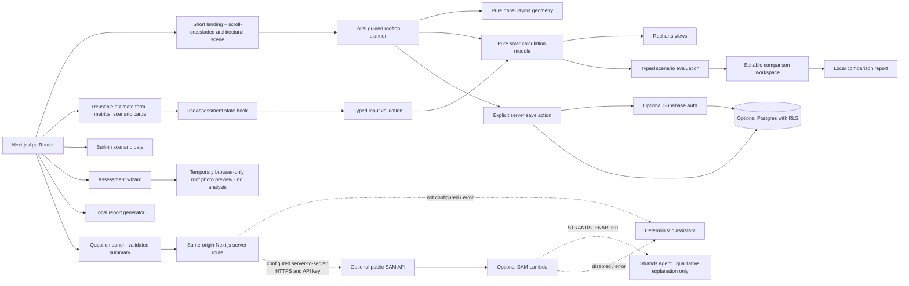

# SolarSmart

A local-first rooftop solar planning application for households and small property owners. Roof layout, shade, energy use, utility rates, installation costs, and export rules all affect a solar decision; SolarSmart puts a transparent first estimate and practical follow-up steps in one experience. It does not certify a roof, confirm eligibility, or guarantee savings.

The complete assessment and demo run locally after dependencies are installed. No AWS account, payment card, API key, login, or AI subscription is needed. All built-in scenarios are illustrative and labelled as demo data.

## Quick start

Requirements for the core application: Node.js 20 or newer and npm. npm is the package manager for this repository (`package-lock.json` is checked in). From the project directory:

```sh
node --version
npm ci
npm run dev
```

Open [http://localhost:3000](http://localhost:3000). The home page is a three-viewport pinned scene: scroll progress smoothly guides the same solar home through daylight, evening storage, and night use. **Build My Solar** opens `/planner`, a six-step local roof and energy planner with optional illustrative battery runtime. The planner works locally with sample/manual location. MapTiler satellite-hybrid imagery and Geoapify India-biased address suggestions are separate optional services with separate public keys; without them, manual planning remains available. `/assessment` keeps the established property wizard; `/assessment?scenario=balanced` opens the built-in medium-roof dashboard demo directly. The standard demo does not send personal details or roof data to an external service.

To build and serve the production version locally:

```sh
npm run build
npm run start
```

The production server defaults to port 3000. For a different port, set `PORT` in the shell before `npm run start`.

## Demo walkthrough

Start at the landing page’s **Build My Solar** CTA or use the six-step `/planner` experience. Choose a sample home, enter approximate rectangular roof dimensions, choose and place demo panels, then enter monthly kWh directly, infer it from a monthly bill and your tariff, or make a rough watts-and-hours appliance estimate. Optionally inspect a 5 or 10 kWh battery runtime illustration, then review assumptions before calculating. The roof grid uses panel dimensions, gaps, and edge clearances from `src/lib/panel-layout.ts`; activate a panel to remove that exact module, or restore the layout. Battery runtime is divided by the average household load; battery price and its effect on savings are deliberately excluded. Solar scenarios use the same deterministic engine as the dashboard. **Use Demo Home** and **Reset to demo values** restore the example. The planner map loads satellite imagery automatically when MapTiler is configured and address suggestions when Geoapify is configured. Selecting a result uses its returned coordinates directly, moves the Leaflet map immediately, and updates the planner location; manual dimensions remain the source of roof size. **Print / save as PDF** opens the browser print dialog for the current planner report.

The established `/assessment` flow remains available. Enter a general city/postcode, property and roof details, and either a monthly bill or kWh consumption. Review or edit each section before calculating. Roof area supports sq ft and m²; unknown tariffs and orientation use disclosed generic assumptions. **Restart** clears the wizard, while **Cancel** returns home. Calculation opens the dashboard with the entered roof, shading, orientation, rate, and energy values mapped into the same deterministic model. The dashboard’s **Edit assessment** returns to the reviewed wizard inputs. Use **Compare scenarios** to open a dedicated decision-support workspace: keep the assessment as the fixed baseline, create/rename/duplicate/remove alternatives, adjust assumptions, and export a side-by-side report. The comparison pins baseline annual kWh (inferred from bill and tariff if no explicit use was collected), so a tariff what-if changes price without silently changing consumption. **Reset samples** restores the three alternatives; **Reset comparison** also resets the local comparison state. The separate sample scenario routes remain available; **Reset demo** restores dashboard defaults. The Report panel provides text/CSV exports, browser printing, and optional local history. **Ask about this assessment** uses the deterministic local assistant unless you deliberately configure a server-side Strands service.

At tablet widths the header collapses to an accessible menu; at phone widths scenario cards and the footer stack, while metric cards remain in a two-column grid. Navigation links jump to real page sections. No external imagery, account, or remote service is needed for the walkthrough.

### Three-minute judge presentation

1. **Frame the problem:** Rooftop solar decisions involve roof suitability, system size, energy use, utility rates, installation cost, savings, and payback. These are difficult to reason about when assumptions are scattered or hidden.
2. **Introduce the solution:** Open the landing page. Point out the scroll-linked sun-to-home energy story, the sample preview, and clear local-demo labels. Explain that a city or postcode is context only; the planner does not look up a home or pretend to have live solar data.
3. **Build a plan:** Select **Build My Solar**, use the demo home, edit a roof dimension or shading, and remove a specific panel. Enter or retain the sample energy use and review the live engine-backed summary.
4. **Explore alternatives:** Calculate the plan and choose a conservative, current, or roof-constrained scenario. Show how panel layout, capacity, generation, savings, cost, and payback move together.
5. **Open the results dashboard:** Go to the established sample assessment to show detailed charts, assumptions, recommendations, local assistant fallback, report, and scenario comparison. Explain that the calculator remains the sole numerical authority.
6. **Close with a report and architecture:** Print the planner or use the dashboard report export. Explain that the planner, calculator, demo scenarios, and local history do not need AWS; the SAM API is an optional server-side enhancement.

For a fast judge path, start at `/`, click **Build My Solar**, keep the demo home, inspect the panel grid, and calculate. Then open `/assessment?scenario=balanced#dashboard` for the full result dashboard and comparison/report flow. **Reset to demo values** restores the planner example; **Reset demo** restores the dashboard sample.

### Product choices and what is distinctive

SolarSmart's useful distinction is the flow from an approachable intake to traceable estimates: the wizard, editable scenarios, dashboard, recommendations, and export all use one deterministic calculation contract. It separates entered values, model assumptions, calculated facts, and unknowns in the UI. The scenario workspace makes trade-offs visible while warning when several variables change together. Optional AI explains a structured summary only; it cannot become a second financial calculator. This is a product and architecture choice, not a claim of a new scientific solar model or proven user outcome.

The landing page uses a locally bundled, matched day/sunset/night architectural image sequence with a stable camera composition. One normalized scroll-progress value crossfades the frames without a React render loop or 3D runtime; reduced-motion mode provides keyboard-accessible Day/Evening/Night controls. The generated visual is illustrative, not a verified property or solar installation. The local planner separates roof-grid geometry (`src/lib/panel-layout.ts`) from energy and financial estimation (`src/lib/solar.ts` and `src/lib/planner.ts`). Displayed panel dimensions, regional factors, currency, battery runtime, and costs are illustrative defaults, not vendor or market specifications. See [planner model and assumptions](docs/planner-model.md).

## Optional accounts and project storage

The full planner and assessment remain usable with all Supabase variables blank. If you deliberately configure a Supabase project, `/login`, `/signup`, `/forgot-password`, and `/dashboard` enable provider-managed authentication and per-user saved solar projects. A project save is explicit: the server validates inputs and recalculates results using SolarSmart’s engine before writing the project and related roof, system, and assessment records. Open a saved project and choose **Continue editing this plan** to reopen its validated planner inputs; edits are marked unsaved until **Update saved project** succeeds. Email, roof photos, and passwords are not written to SolarSmart project tables; Supabase Auth alone processes passwords. The frontend uses only the Supabase publishable/anon key, and database access is restricted by RLS policies.

1. Create a Supabase project yourself and review its current pricing, data region, quotas, and retention requirements. SolarSmart does not create a project automatically.
2. Copy `.env.example` to `.env.local`; set `NEXT_PUBLIC_SUPABASE_URL`, `NEXT_PUBLIC_SUPABASE_PUBLISHABLE_KEY` (or the older `NEXT_PUBLIC_SUPABASE_ANON_KEY`), and `NEXT_PUBLIC_SITE_URL`. The publishable/anon key is intended for browser use only with Row Level Security enabled. Never use a service-role key in this app or expose one through `NEXT_PUBLIC_*`.
3. Apply both SQL migrations with the Supabase CLI after linking the project, for example `npx supabase link --project-ref YOUR_PROJECT_REF` followed by `npx supabase db push`. Review the SQL and target project before applying. Alternatively, run `202610090001_initial_schema.sql` followed by `202610090002_atomic_project_save.sql` in the Supabase SQL editor.
4. In Supabase Auth settings, configure the allowed site URL and redirect URL `http://localhost:3000/auth/callback` for local development; set the corresponding HTTPS URL in production. Configure email delivery and password/recovery policy in Supabase.
5. Restart `npm run dev`. Check sign-up email confirmation, sign-in, recovery, project save, RLS-protected listing, rename, detail, delete, and sign-out using test accounts.

The included migration creates private profiles, solar projects, roof/system configuration, energy assessment, and report metadata tables with foreign keys, indexes, and owner policies. Report metadata is not written automatically; downloaded reports stay local. Deleting a project cascades to its related records. The optional Supabase integration has not been connected to or verified against a live project. Requests, database size, email delivery, backups, and hosting can incur charges; check current Supabase pricing and limits.

## Optional planner map

The planner uses Leaflet with MapTiler’s `hybrid-v4` Satellite Hybrid raster tiles and Geoapify Address Autocomplete. These are separate services: `NEXT_PUBLIC_MAPTILER_API_KEY` is required for imagery, while `NEXT_PUBLIC_GEOAPIFY_API_KEY` is required for address suggestions. Add both public keys to `.env.local` for local development and the Amplify branch environment variables for hosting, then restart/redeploy. Restrict each key to the API it needs and the local/deployed website origins; both are browser-visible keys, never private server credentials. Geoapify's [Address Autocomplete API](https://apidocs.geoapify.com/docs/geocoding/address-autocomplete/) is used because it returns coordinates with suggestions and allows a soft country bias. SolarSmart applies `bias=countrycode:in`, prioritizing Indian results without restricting international matches. Geoapify coverage comes from its data sources and varies by locality; an Indian PIN-code result may represent an area rather than a rooftop. Its current Free plan lists 3,000 credits/day and no credit card requirement; each autocomplete request costs one credit, and its pricing page permits commercial use within plan limits. Review [current pricing and quotas](https://www.geoapify.com/pricing/) and [terms](https://www.geoapify.com/terms-and-conditions/). Geoapify requires Geoapify attribution on the Free plan and OpenStreetMap attribution; the map attribution and search attribution are displayed. Google Places API autocomplete was considered, but it requires a billing-enabled Google API project and its [policy](https://developers.google.com/maps/documentation/places/web-service/policies) requires Places results displayed on a map to appear on Google Maps, so it is incompatible with this existing Leaflet/MapTiler map. Google's separate Geocoding API has a similar Google-Map display condition. Mapbox Search Box was not selected because its [documented supported geographies](https://docs.mapbox.com/api/search/search-box/) are the US, Canada, and Europe. MapTiler remains the imagery provider; its separate quotas, license, and required MapTiler/OpenStreetMap attribution still apply—review [MapTiler pricing and license](https://www.maptiler.com/cloud/pricing/) for public use. Selecting a suggestion uses its returned coordinates directly, updates the planner, and flies to a zoom level that reflects result precision; the marker remains draggable. Device geolocation is never requested. When keys are missing or imagery fails, a setup/error message appears while sample/manual roof inputs remain usable. Satellite imagery is visual context only, not a roof survey or measurement.

Optional `NEXT_PUBLIC_MAP_TILE_URL` and `NEXT_PUBLIC_MAP_TILE_ATTRIBUTION` can replace the default public imagery endpoint; they do not replace the Geoapify address-search service. These are browser-visible configuration and must not contain private credentials. A custom tile provider must be licensed for this use and its required attribution supplied. The selected city/address coordinates do not prove a rooftop location.

To enable India-biased search, create a project in [Geoapify MyProjects](https://myprojects.geoapify.com/), enable Address Autocomplete for its key, and set `NEXT_PUBLIC_GEOAPIFY_API_KEY` in `.env.local` and the AWS Amplify `main` branch environment variables. Restrict the key to Address Autocomplete and allow the origins `http://localhost:3000` and `https://main.d1ifsf72k3a4lj.amplifyapp.com`. Keep `NEXT_PUBLIC_MAPTILER_API_KEY` separately configured for satellite tiles only. Both keys are public browser keys. After adding the Amplify variable, trigger a new build so Next.js includes it in the browser bundle.

Future extensions could add validated location-specific weather and tariff sources, installer quote comparison, account-based syncing, or a tested vision method. Each would need disclosed provenance, user consent, security and retention design, and a comparison against the current deterministic assumptions before it could replace or augment demo inputs. None is represented as implemented today.

## What the estimate means

The calculator in `src/lib/solar.ts` is a pure, deterministic, separately tested TypeScript module. It returns a versioned typed schema with calculation assumptions, annual projections, warnings, limitations, completeness, and confidence. Consumption from a bill is inferred as bill × 12 ÷ entered/disclosed tariff. System sizing uses a target annual consumption offset and is capped by usable-roof capacity (60 sq ft/kW). Generation applies peak sun-hours × 365 × generic 80% performance × orientation × shade. The financial model distinguishes an illustrative physical self-consumption share from exports: self-consumed kWh offset the retail rate, while exports use only the explicit export-compensation input (zero by default). Installation cost range, incentive adjustment, degradation, tariff growth, payback, and emissions use documented assumptions. Charts and reports consume the engine’s annual projection instead of recalculating it. See [the full model documentation](docs/calculation-model.md) for formulas, units, constants, bounds, and limits.

Rates, sun-hours, roof area, cost, self-consumption, export compensation, performance, degradation, and the generic 0.385 kg CO₂/kWh factor are illustrative or user-provided, not local verified facts. Subsidies default to 0%; any entered incentive is unverified and warned. Results are estimates, not installer quotes, engineering assessments, approvals, or guarantees. Actual generation and costs depend on site, equipment, local conditions, utility rules, and installation quality.

## Optional roof photo preview

The Roof and site step accepts an optional JPEG, PNG, or WebP file up to 8 MB. The browser validates the declared image type and size, decodes it locally, applies preview dimension limits, and displays a temporary preview. Cancel, remove, Restart, replacement, or leaving the wizard clears or releases that preview. The image is not uploaded, saved in assessment history, included in reports, or sent to the optional assistant. It does not affect the calculation; users still enter usable area, shading, and orientation manually. This project has no configured vision model or image-analysis dependency, so SolarSmart makes no machine-generated roof observations. A photo alone cannot establish area, structural condition, production, eligibility, or engineering safety.

Invalid provided inputs return structured validation errors; missing data yields `null` estimates and warnings. Zero bill/zero roof does not divide by zero, a zero tariff is invalid, and payback beyond the 25-year modeled horizon remains unavailable. Invalid edits hide dependent dashboard results until corrected. Scenario comparison uses the same engine, keeps baseline usage fixed while editing the tariff, and marks invalid alternative outputs unavailable.

The results dashboard includes six summary metrics, an engine-backed annual generation/savings/cost-recovery chart set, dashboard scenario switching for small, medium, and highly shaded sample roofs, and a dedicated CRUD comparison workspace at `/assessment/compare`. It includes source-labelled inputs/assumptions/calculations, limitations, deterministic next-step recommendations, and a checklist. **Report** opens a current-result report preview with plain-text and structured CSV export, plus browser printing (choose “Save as PDF” in the browser print dialog). The report is rebuilt from the current calculation output; it does not contain a second calculator. A valid assessment can be explicitly saved from the report to optional local browser history. History supports reopen, rename, delete, and clear all. Its versioned schema migrates known older entries, skips malformed entries with a notice, and preserves unsupported future versions rather than overwriting them. Local storage may be unavailable or cleared by browser privacy settings. Monthly production is intentionally left unmodelled because the app has no defensible seasonal or location-specific profile.

## Known limitations

- Solar yield, emissions factor, equipment performance, and default financial inputs are generic planning assumptions, not a local forecast, live measurement, quote, or verified tariff.
- The optional autocomplete sends typed search text to Geoapify after three characters; map availability depends on configured keys, provider policies, and connectivity. Indian coverage varies by locality, and PIN-code results may represent broad areas. Roof images are only previewed locally; there is no vision service or dimension measurement.
- The model does not inspect roof structure, wiring, permitting, legal eligibility, utility approvals, or installer quality. A qualified local professional must assess those conditions.
- Savings and simple payback exclude financing, maintenance, insurance, taxes, fixed utility charges, and changing export terms. No subsidy is assumed by default; any user-entered incentive remains unverified.
- Local history and comparison handoff data remain in the current browser and do not sync across devices. Browser storage settings may clear or block saved history.
- Strands/Bedrock explanation is optional and may incur inference charges. AWS account resources, cloud history, hosted web delivery, and uploaded image storage are not part of the core demo.

## Checks

```sh
npm test
npm run typecheck
npm run lint
npm run build
python -m unittest discover -s backend
```

The first four commands check the Next.js app, TypeScript, and frontend tests. The Python command checks the optional Lambda handler's validation and fallback logic; it does not invoke AWS or a model. SAM validation/build and Docker-backed Lambda emulation are optional checks and require their respective tools.

## Technology stack and rationale

- **Next.js App Router + React + TypeScript:** typed page routing, server/client boundaries, and a maintainable UI without requiring a separate hosted API for the local experience.
- **OGL (decorative WebThreads background):** provides the existing optional WebGL thread effect with a CSS gradient fallback. Homepage photography and the planner do not depend on WebGL.
- **Locally bundled generated scene frames:** matched architectural day, evening, and night visuals are crossfaded on scroll. No image host, image API, or external asset request is required.
- **Tailwind CSS / repository CSS design tokens:** utility styling plus shared semantic colors, spacing, focus states, and responsive rules. The reusable controls in `src/components/ui` are accessible project components; shadcn/ui is not a runtime dependency.
- **Leaflet + MapTiler + Geoapify (optional configured map):** MapTiler provides satellite-hybrid imagery with labels; Geoapify provides India-biased address autocomplete; Leaflet handles map navigation and approximate marker selection. Separate origin-restricted public keys are required for imagery and search. Both services remain subject to quotas, licensing, and network availability; neither is required for core estimates.
- **Recharts:** responsive charts receive the calculation engine's projection data. They do not make independent solar or financial calculations.
- **Vitest:** fast unit tests for deterministic calculations, validation, comparison, reports, persistence, assistant contracts, and image handling.
- **Python 3.12 + AWS SAM + optional Strands Agents:** only for the optional serverless explanation API. It is not required to run, test, or build the core Next.js experience.

No remote image host, font service, analytics provider, database, or AI client SDK is required by the browser demo. The WebThreads background renders locally and the architectural scene frames are bundled in `public/images`.

## Architecture



Component boundaries: `src/app/layout.tsx` mounts one persistent `GlobalBackground` (`src/components/solar/global-background.tsx`) for every route. It reuses the OGL-based `WebThreads` renderer (`web-threads.tsx`, `WebThreads.css`) behind readable page shells. The landing page uses `solar-story.tsx` to drive the matched local images in `public/images/solar-home-*.png` through `cinematic-solar-scene.tsx`; no 3D renderer or WebGL is needed for the house scene. Semantic design tokens live in `src/app/design-system.css`; dark glass surfaces, palette, and route-level contrast adjustments live in `src/app/globals.css`. `src/app/page.tsx` composes the landing; `src/app/planner/page.tsx` and `src/components/solar/solar-planner.tsx` handle the guided home/roof/panels/energy/battery/review flow; `src/lib/panel-layout.ts` and `src/lib/planner.ts` handle panel geometry and planner estimates. The solar financial authority remains `src/lib/solar.ts`. Optional server authentication lives in `src/lib/supabase`, `src/app/auth-actions.ts`, and the migration in `supabase/migrations`; `src/app/project-actions.ts` revalidates and recalculates before explicit account persistence. The established assessment wizard, dashboard, comparisons, reports, and assistant remain separate modules.

## Delivery status

Implemented: compact pinned solar story with photorealistic illustrative day/evening/night image compositing, scroll-controlled transitions, and reduced-motion controls; six-step local rooftop planner with proportional panel geometry, selectable modules, live scenarios, and optional average-load battery illustration; optional Supabase authentication actions, recovery flow, owner-scoped project save/list/detail/rename/delete, and an RLS migration; existing assessment wizard/dashboard, deterministic engine, comparison, local assistant fallback, reports, and local history.

Not configured or live-tested: Supabase authentication/database (requires a user-owned project, applying the migration, email settings, and environment values), Strands/Bedrock inference, AWS deployment, map/location lookup, live tariff/irradiance feeds, automated imagery analysis, or installer matching. No resources are deployed automatically. No partnerships, government data, or subsidy database are claimed.

### Implemented versus prepared integrations

| Integration | Current status |
| --- | --- |
| Local Next.js UI, wizard, calculation engine, sample data, charts, comparison, report, local history | Implemented; does not need AWS credentials or network access at runtime. |
| Supabase Auth/Postgres | Optional auth flows and RLS schema are implemented; requires a user-owned project and applying the migration. No live Supabase project was available for integration verification. |
| Strands explanation endpoint | Optional server-side Lambda/API integration is implemented in `backend/app.py` and `template.yaml`; defaults disabled and has deterministic fallback. Model inference was not verified as part of the local demo. |
| AWS Lambda, API Gateway, CloudWatch | Included in the optional SAM assistant stack. SAM template validation/deployment status depends on running SAM and reviewing the target account's change set; no resources are deployed automatically. |
| AWS Amplify Hosting | Prepared for Git-based Next.js 15 SSR deployment with `amplify.yml` and common security headers. Requires owner-authorized Git connection, account/region review, and console configuration; no AWS app or resource has been created. See [AWS deployment guide](docs/optional-aws-deployment.md). |
| S3 user uploads/report storage, DynamoDB, Cognito, CloudFront | Future integration points only. No adapters, application flows, or resources for these services are implemented. |
| LocalStack | Not used. SAM Local is the optional emulator for the one implemented Lambda/API path. |

Avoid describing an optional service as deployed or tested in AWS unless that has been done in the target account. Follow the deployment guide's resource and cost review before any cloud action.

## LocalStack

LocalStack is not included: the app creates no S3 or DynamoDB resources, and SAM Local already covers the optional Lambda/API route. If you later add AWS services, use LocalStack only after checking that the specific service and feature are supported by your chosen LocalStack edition; no LocalStack edition is required or assumed here. Strands/Bedrock model access is not part of the local demo and may still require AWS credentials and paid model usage. See [optional AWS deployment and validation details](docs/optional-aws-deployment.md).

## Optional AI assistant and Strands

The assistant works without an AI SDK, API key, AWS account, or network connection. Its deterministic local fallback answers questions from the current calculation, separates engine facts from model assumptions and unknowns, and can summarize the built-in scenario estimates. The model is only called after a user submits a question. The browser calls same-origin `/api/assistant`; provider credentials and the upstream URL stay server-side. The question, non-location calculation inputs/results, assumptions, warnings, and scenario summaries may be sent to the endpoint configured by the application operator. City/postcode, report history, and roof images are excluded from the assistant payload. Do not type personal or account details into the question.

Strands Agents is optional and is present in `backend/requirements.txt`. The SAM Lambda uses Bedrock only when explicitly enabled. The SDK is an open-source agent framework, not a free inference service; Bedrock inference is priced by model/provider and usage, and requires model access plus AWS credentials/IAM. Check the current [Strands Python quickstart](https://strandsagents.com/docs/user-guide/sdk/quickstart/python/) and [Bedrock pricing](https://aws.amazon.com/bedrock/pricing/) before enabling it. No model request is made by the standard local demo.

To run the optional API locally, install SAM CLI and Docker, then:

```sh
sam validate --lint
sam build --config-env default
sam local start-api --config-env local
```

Set `SOLARSMART_AI_ENDPOINT=http://127.0.0.1:3001/explain` in `.env.local` and restart Next.js to test the local SAM bridge; its local profile disables the API key and Strands. To try the model path, set the SAM `StrandsEnabled=true` parameter and a supported `StrandsModelId`, then configure Bedrock model access for the Lambda execution role. The template default is disabled. For hosted Amplify, set `SOLARSMART_AI_ENDPOINT`, `SOLARSMART_AI_API_KEY_PARAMETER`, and `SOLARSMART_AI_SECRET_REGION` as server-only/non-secret configuration; store the API Gateway key as an SSM `SecureString` and grant only the Amplify SSR Compute role access to that parameter. Do not set the API key in Amplify environment variables, `.env.production`, or a `NEXT_PUBLIC_` variable. Remote model calls require a verified Supabase session. If configuration, auth, SSM, or the upstream model fails, local deterministic guidance remains available.

To disable the model, clear `SOLARSMART_AI_ENDPOINT` in Next.js or deploy/run SAM with `StrandsEnabled=false`; the local assistant still works. For Amplify, keep the API Gateway key in an SSM Parameter Store `SecureString`; the Next.js server retrieves it through a least-privilege SSR Compute role, never from a `NEXT_PUBLIC_` variable or build artifact. Remote model calls require a verified Supabase session; anonymous users continue to receive deterministic local answers. Inference may incur token charges. SAM/API Gateway/Lambda and logging may also incur charges if deployed; use the optional deployment cost review below before creating any cloud resources.

## Optional AWS deployment

Deployment is never part of local setup. The only included cloud backend is the optional SAM assistant API. Review its resource list, security model, cost risks, deployment profiles, validation limits, rollback, and cleanup steps in [the AWS deployment guide](docs/optional-aws-deployment.md) before considering deployment. Do not assume Free Tier eligibility or that quotas are hard spending limits.

## Privacy and troubleshooting

- `.env.example` lists optional settings; local mode needs none. Keep real secrets and model endpoint URLs server-side, never in `NEXT_PUBLIC_*` variables.
- The assistant sends a validated minimal assessment summary only after the user asks a question. With no configured endpoint, answers are generated locally. Disable AI by leaving `SOLARSMART_AI_ENDPOINT` empty.
- User inputs stay in browser state unless the user explicitly saves an assessment. Optional history stores only assessment inputs/context in this browser’s local storage; it does not sync and includes no roof images. Use **Delete all local history** in the History panel to remove it. Browser privacy settings may block or clear storage.
- Report text/CSV exports are generated client-side. Browser print can be used to save a PDF; no remote PDF service is used. Export actions report a failure if browser download/print setup throws; the browser controls the final save location.
- If install fails, check Node.js 20+ and rerun `npm install`. If port 3000 is busy, run `npm run dev -- -p 3002`.
- If a production build in a OneDrive-synced folder fails with an `EINVAL`/`readlink` error under `.next-build-solarfix`, retry into a fresh ignored output directory in PowerShell: `$env:SOLARSMART_NEXT_DIST_DIR = ".next-build-retry"` then `npm run build`. Choose a new directory name if that output also contains stale OneDrive metadata. This changes only Next.js build output; it does not alter source files or the development server.
- If a chart is blank, reload and confirm JavaScript is enabled. The calculator outputs are available without charts.
- If SAM local startup fails, install Docker and SAM CLI; otherwise simply skip the optional API.
- If optional Strands fails due to missing model permissions, region, or credentials, disable it and retain the fallback. Model calls may be billable.
